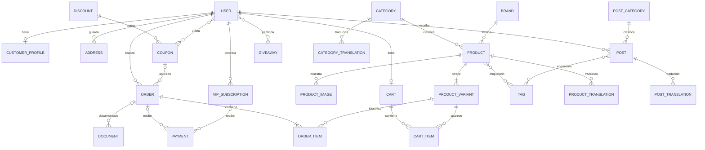

# Sprint 2: diseño de la base de datos

Estado: diseño confirmado e implementado. Los resultados de verificación se documentan en `sprint-2-comprobacion.md`.

## Objetivo

Preparar las tablas y relaciones de la memoria de FitStore. En este sprint se crearán migraciones, modelos, factories, seeders y pruebas; las pantallas y los endpoints se desarrollarán después.

## Decisiones propuestas

- Cada producto pertenece a una categoría y una marca.
- Cada producto tiene al menos una variante. La variante contiene el SKU, el precio y el stock. Un producto sin tallas, colores ni sabores tiene una variante estándar.
- Un usuario tiene un carrito actual. No puede repetir una variante en varias líneas del mismo carrito: cambia la cantidad de la línea existente.
- Cada pedido admite como máximo un cupón. Se guardan el código aplicado y el importe descontado para conservar el historial.
- Las líneas del pedido guardan una copia del nombre, SKU y precio comprado. El pedido conserva una copia de la dirección de entrega y de los datos de facturación necesarios.
- Los importes se guardan como céntimos enteros y la moneda como EUR inicialmente. Por ejemplo, 1999 representa 19,99 EUR. Se incluyen subtotal, descuento, envío e impuestos por separado. Esto facilita cálculos exactos también con SQLite.
- Los porcentajes de descuento son enteros entre 1 y 100; los descuentos fijos se expresan en céntimos. El redondeo se define al calcular el descuento.
- Los pagos son simulados. Un pago pertenece a un pedido o a una suscripción VIP, nunca a ambos ni a ninguno.
- La suscripción vigente determina el acceso VIP. No se guarda un segundo indicador VIP independiente en el perfil.
- Las traducciones contienen los textos en español e inglés y tienen una combinación única de entidad e idioma.
- Los roles y permisos se dejan para el sprint correspondiente, con las tablas de Laravel Permission indicadas en la memoria. No se añade ahora un campo de rol alternativo.

## Entidades

Todas las tablas de entidad tendrán identificador y fechas de creación y actualización, salvo una razón documentada. Las claves foráneas y las restricciones se concretarán en las migraciones.

| Modelo | Tabla | Datos principales y motivo |
|---|---|---|
| User | users | Identidad, correo único, contraseña e idioma. Ya existe en Laravel. |
| CustomerProfile | customer_profiles | Usuario único, teléfono y puntos. Separa los datos adicionales de cliente. |
| Address | addresses | Usuario, destinatario, dirección, localidad, provincia, código postal y país. Permite varias direcciones. |
| Category | categories | Nombre, slug único y estado activo. Clasifica el catálogo. |
| Brand | brands | Nombre y slug único. Permite filtrar por marca. |
| Product | products | Categoría, marca, nombre, slug único, descripción, activo y destacado. Representa el producto general. |
| ProductVariant | product_variants | Producto, SKU único, talla, color, sabor o formato opcionales, precio en céntimos, stock y activo. Es la unidad que se vende. |
| ProductImage | product_images | Producto, ruta, texto alternativo y posición. Permite varias imágenes. |
| Tag | tags | Nombre y slug único. Clasificación reutilizable de productos y publicaciones. |
| Cart | carts | Usuario único y última actividad. Permite consultar y limpiar carritos. |
| CartItem | cart_items | Carrito, variante y cantidad. Única por carrito y variante. |
| Discount | discounts | Nombre, tipo fijo o porcentaje, valor, vigencia, activo y solo VIP. Define una promoción automática o una regla utilizada por cupones. |
| Coupon | coupons | Descuento, código único, vigencia, mínimo de compra y límites de uso global y por usuario. Permite validar códigos. |
| Order | orders | Usuario, cupón opcional, número único, estado, moneda, importes y copia de dirección y facturación. Conserva la compra. |
| OrderItem | order_items | Pedido, variante, nombre y SKU históricos, cantidad, precio unitario y total de línea. Conserva lo vendido. |
| VipSubscription | vip_subscriptions | Usuario, inicio, fin, precio, moneda y estado. Permite historial de altas y renovaciones. |
| Payment | payments | Pedido o suscripción, referencia única, importe, moneda, estado y fecha de pago. Permite intentos de pago. |
| Giveaway | giveaways | Título, descripción, premio, fechas, estado y usuario ganador opcional. El ganador debe ser participante. |
| PostCategory | post_categories | Nombre y slug único. Clasifica el blog sin mezclarlo con el catálogo. |
| Post | posts | Autor, categoría de blog, título, slug único, contenido, estado y fecha de publicación. Representa el blog. |
| ProductTranslation | product_translations | Producto, idioma, nombre y descripción. Única por producto e idioma. |
| CategoryTranslation | category_translations | Categoría, idioma y nombre. Única por categoría e idioma. |
| PostTranslation | post_translations | Publicación, idioma, título y contenido. Única por publicación e idioma. |
| Document | documents | Pedido opcional, usuario generador opcional, tipo, nombre y ruta. Permite facturas e informes generales. |

Se conservan las tablas técnicas originales de Laravel. No cuentan como modelos de negocio para cumplir el mínimo de la API.

## Relaciones principales

El diagrama representa reglas de negocio. La condición de tener al menos una variante o una línea de pedido requiere validación desde código; una clave foránea por sí sola no la garantiza. La pertenencia exclusiva del pago sí se comprobará con una restricción de base de datos.

## Tablas pivote

| Tabla | Claves | Columnas adicionales |
|---|---|---|
| product_tag | product_id, tag_id | priority, is_visible y fechas |
| post_tag | post_id, tag_id | Fechas |
| coupon_user | coupon_id, user_id | used_at, times_used y fechas |
| giveaway_entries | giveaway_id, user_id | joined_at y fechas |

Cada pareja de claves será única. El código demostrará `attach`, `updateExistingPivot` y `syncWithoutDetaching`, además de consultar los valores mediante `pivot`.

`coupon_user` resume el uso por cliente. Los pedidos conservan el cupón aplicado a cada compra. Al implementar el checkout, ambos registros se actualizarán juntos en una transacción.

## Restricciones e índices

- Claves foráneas en todas las referencias a otras tablas.
- Campos únicos para correo, slug dentro de cada tabla, SKU, código de cupón, número de pedido y referencia de pago.
- Cantidades positivas, precios e importes no negativos, stock y puntos no negativos.
- Fechas de fin posteriores a las de inicio, porcentajes válidos y estados admitidos.
- Índices compuestos según las consultas previstas: categoría y activo; marca y activo; usuario y fecha de pedido; estado y fecha de pedido; estado y fechas de publicación o sorteo.
- Evitar índices redundantes con los que ya generan las claves únicas.
- Restricciones probadas realmente en SQLite, no depender solo de tipos `unsigned`.
- Borrado lógico de usuarios, productos y variantes para conservar referencias históricas. No borrar en cascada pedidos ni pagos al retirar un producto o usuario.
- Borrado en cascada de datos dependientes sin historial propio, como traducciones o líneas de un carrito eliminado.

## Factories y seeders

- Factories para las entidades con campos coherentes y estados de prueba: producto inactivo, pedido pagado, cupón caducado y suscripción vigente, por ejemplo.
- Semilla aleatoria y fechas de referencia fijas para poder repetir los datos de demostración.
- Categorías, marcas y etiquetas deportivas; productos con variantes; usuarios y direcciones; carritos; pedidos con importes coherentes; pagos simulados; cupones; sorteos; publicaciones y traducciones.
- Los pedidos de ejemplo conservarán precios y direcciones históricos.
- No crear usuarios con roles ficticios antes de incorporar el sistema de permisos.
- La reconstrucción y carga inicial se verificará en una base separada. La base actual no se borra.

## Pruebas y cierre

1. Crear el esquema completo desde cero en SQLite de pruebas.
2. Comprobar factories y carga de seeders.
3. Probar relaciones uno a uno, uno a muchos y muchos a muchos, en ambos sentidos cuando corresponda.
4. Añadir y actualizar campos pivote desde código y verificar lo guardado.
5. Rechazar duplicados, referencias inexistentes, importes o cantidades inválidos y pagos con pertenencia incorrecta.
6. Comprobar que la edición posterior del catálogo no modifica las líneas históricas de pedidos.
7. Verificar que los datos de ejemplo mantienen importes, fechas y relaciones coherentes.
8. Documentar los comandos ejecutados y sus resultados.

Las pruebas del sprint se escriben con Pest y su integración con Laravel. Pest utiliza PHPUnit internamente.

## Motor de base de datos

La implementación utiliza SQLite, que es el motor ya configurado en el proyecto. Las migraciones de negocio declaran SQL explícito para incluir restricciones CHECK reales en SQLite. Incluyen claves foráneas y usan Schema para los índices. Migrar en el futuro a MySQL requerirá adaptar ese SQL; no se afirma compatibilidad con otros motores.

Los triggers de sorteos garantizan que el ganador sea participante e impiden borrar o cambiar su participación. Las demás reglas que requieren varias filas, como que un pedido tenga líneas y sus importes sumen el subtotal, se comprueban en los datos de ejemplo y las pruebas; el checkout deberá mantenerlas dentro de una transacción.

Las factories permiten crear entidades aisladas para pruebas. `Product::factory()->withVariants()` y `Order::factory()->withItems()` crean ejemplos con sus dependencias completas. Los seeders crean el conjunto de demostración con valores y fechas fijos, sin depender de la fecha actual ni de valores aleatorios.

La aplicación usa la conexión SQLite habitual de Laravel y `database/database.sqlite`. Las pruebas automáticas utilizan SQLite en memoria, como ya estaba configurado en el proyecto. No hay conexiones adicionales ni comandos Artisan propios.

## Bloques y commits sugeridos

1. Documentación: `Sprint 2: definir el modelo de datos`.
2. Migraciones: `Sprint 2: crear tablas y restricciones`.
3. Modelos: `Sprint 2: añadir modelos y relaciones`.
4. Datos: `Sprint 2: añadir factories y seeders`.
5. Pruebas: `Sprint 2: comprobar estructura y relaciones`.

El usuario realiza los commits y las subidas. No se ejecutan automáticamente.

## Revisión previa de Git

La aplicación y su repositorio Git están en `C:/Users/juano/Desktop/php/FitStore`. GitHub Desktop debe abrir esa carpeta, que contiene `artisan`, `app` y `database`.
